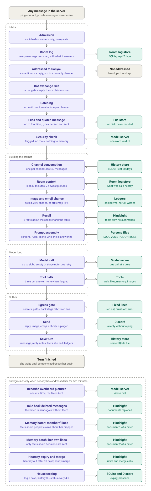

# Message flow

How one Discord message moves through the bot. Every message goes into the room log and, later,
into memory. Only a message addressed to Sanya goes on to produce a reply.

The values behind each box (how many messages, how long, what chance) are in
[SETTINGS.md](SETTINGS.md). This file shows the order of the steps.

## Diagram

The picture is [flow.svg](flow.svg). It
reads top to bottom: the left column is the path of a message, and the boxes on the right are the
stores and services each step uses. The dashed box at the bottom is background work, which is fed
by the room log and not by the reply.

### Zoomable version

The same flow as a diagram you can zoom and pan: [open it in the Mermaid viewer](https://mermaid.live/view#pako:eNp9V1GP2zYM_itCgGEtkOu624YN16JDErt3QZNzFntdgWYPiq3EWmzJleTmgqL_fSRlO3ZS9F6so0SK_PiRVL6MUp2J0R0b7Qp9THNuHEuCjWLwZ-vt3vAqZ_PHZPIu_LgZzZXjB7EZ_esP4N8kWMLGJCultVKr11vz0xt7lC7NRXajFbPCfBbGMq2K05gpzYyoBHd2YGQR3YORtdYlK_SebAjQOrFSWMv3YszAYs6OOXdMOsaVPYLNCz-C9Rd0JDOgIzLmNMuFGZMxqRhnEJxSomA2F6zkJ3SkODGp_tyMvp7tTKMkBl-m2jHxhCp7wUxdCLLDvdKYuVygyargaJrcGXgznSSzBzTDAQipfEgQ_JFLNwYsBHO1AU2IhTlZClYJ0zo4DCtJwMxbWQgL92TsU60dBNfgQmbrCmPd6dqAX6dK3AD06QEO4fmDqNzAYBzOwGAs0tpId2J0lszsCr7fi-wOc-S0Lixmy6HzaL4UpTanzpJQ2UZdsGS1jparZP6IqZzWsshIFcCujC6vvIgR5VmTklQrJAl3LYMQoR4kY1Zw69ivL9vAh7mfJR9a-oAlJ54cGSGdX0BHqtoJiOeWKXEUIKxkCvhfWFmGwXyCJC_hAgIPYv5Pkg9pk38LuIKd335opJBLw_RuNzC0DmeTxQI9EikvCtL8g-146hBTJDbBUgoDeAN-ZcmNvHDGgwk2VgQe48DpclucyBggY7XiYyIm2LSpUFgjuSZyS9tQEhLw3YwtomgFVyyhAxRQeLoa4hEF4aLb7iLxdBNynzdMNsJBpVKBcqTMsD8kUbTAVCdAKTJiPdvkzgmoIUyydxbpBtaOWFkNF7_rfPR3Mo0w71HttvppcGl4v_YEC_fYDdieO59AK1JwFyCruMvhs-XpwTrMt-PF4Y7t5BOkpJBKXND1MaCqURmZabqALKk3EU1egftbnZ0Q_QqA73lPFibvsYHG_LMvfTLTdbe2qyBGiCB4RnShdOb8-0BMqeAgkL3RtcrG1GoZB3yBZ0cNLUMK1xbBwKn5ElUDYVMjt4JpYGYuuMm6-iAvkas7aEAY2VU7mU5m7zC7MBYITAZcEb0OddGkl9OfkVHUTOA8NMc7bC1bIPSPBHvDDgqeb3UNtSp0VYhXLIVeW7ZC6OwsM7qqLmCGC26vLsDD-qh69gmh_iV4hBfIP27EdZTLcH2P6XsAdCyMDvFUSbCPPYKqeEi-D6v5mk7r2oqDEFU7AGC2sd9Zxk-Q31xahz7-8hLq13FX228leRnfP8PxqrpRCAOLuoefq6Dz3J98CCfr4FnjY9ZO2uL0qktmG1ajEESPIZ5PcBDtpJLAtcxv-wPrKFp-fHYeywwd9mUU_7WQDnjrg9mMnjeeP8zjBFUemuCuNaAdD1XezhdhjDo443oK8HTIpD20DbOh1VlvEQb34RoVFyLbA3_8oMeKtE1Jjs_UOmJ0vVtX4TqOHieovvLNlCjujWBaz42gH17sg1OZxfbXTaotV4e2YpFaZw3qofH6Per5Purz1qka8anGidS9BM66_4RTVIshn2lOejJtXgFVvS1kyo5i6-eBkZ-hwzHePH4s2xYanwBnY8E8nkXrAA0G0qbaNHsdzdjNzRt8zNEX3mPN_8Han8AViJBWuEFsG-6c4FrcwgeUX-AbyJtJEvrC28PrwKIRxP4sTHD60gymlR-itPSzsEkcrf1ZxLYHM3uNUpo3fSkK_TxornwM_AI6Mi2wEFog2sCR-726IhkxtYm5CagnQo02lHMxdFE2cbd34l6fx-fgLw767ZZ-PWQGPL6GqSf3wZ-Bf92BB8S8wm-4QWj6DaDjlewhvhL1IOmgbsjXgkxH2M0L2IEJ5GWw8JLh_R7VF8Sm2btLGY6Tb8huvQw1vKx1E89fSW6HEmr1Q5Fv6F52JkZfek5nX9qFPRqzEcyJkssMf2nBzxTo4Fjqd2wzyrg5wC8QPMNrp-OTSkHuTA3dclRXGRR2IDmM-rIRf_0fUWIonQ).
The picture above is also [flow.svg](flow.svg) at full size.

## The same flow as steps

### Intake

1. **Admission.** Direct messages are dropped. A message id seen before is dropped.
2. **Room log.** The message is recorded: channel, author, time, id, text. This happens for every message, before anything decides whether she replies. The channel's name is noted with it.
3. **Addressed?** If the message does not @mention her or reply to one of her messages, or the channel is on the no-reply list, the flow ends here. She has heard it and says nothing.
4. **Bot exchange rule.** Only when the author is a bot: she answers the first ping as a reply and a follow-up once more as a plain message.
5. **Batching.** She starts on a message at once; there is no wait for further messages (there was one of 2 seconds). Each message is its own message: a new one from the same member while she is working waits and gets its own reply (until it restarted the turn with both). Messages from one member that are waiting together are answered together. Other members wait their turn.
6. **Attachments.** Up to four files are downloaded, type-checked and stored for the turn.
7. **Security check.** A separate model call judges the message. If it is flagged, or the check fails, the turn runs with tools off, and neither the message nor her answer to it is offered to memory.
8. **Room context.** Recent messages from the same channel are read from the room log.

### Conversation

9. **Channel conversation.** The shared conversation for this channel is loaded from the history store.
10. **Recency window.** Only the last 40 messages are kept for the request.
11. **Media decision.** The turn is marked off, optional or requested, using the media ledger for the cooldown.
12. **Prompt assembly.** Rules, persona, the speaker and date cue, the media cue, room context, and facts recalled from Hindsight about the speaker and the topic. The turn closes with a note naming who she is answering and who she is not.

### Model loop

13. **Model call.** The request goes to the model server. An empty answer, or one that holds a stage note of the kind she is shown, is asked for once more, with a new seed and a note at the end of the conversation telling her to write her message.
14. **Tool calls.** If the model asks for a tool, it runs and the result goes back to the model. This repeats for up to eight model calls. Tools are limited to an allowlist, web fetches refuse private addresses, and a flagged turn has no tools.
15. **Leak replacement.** A reply that talks about her prompt, backend or machinery is replaced with an in-character brush-off. So is a reply that concedes she is holding something back, when the message asked about her instructions or was flagged.
16. **Save turn.** The message, the reply and any tool results are written to the history store. A copy of the facts she had from memory for the reply is kept beside it, for the monitor; she is never shown it.

### Outbox

17. **Media grant.** An image goes out only if she found it with a tool this turn, it passed the checks, and it has not been posted in the server in the last day. An image link she writes into her text is removed.
18. **Egress gate.** A reply containing a path, private address, secret or internal tool name is replaced whole by her refusal line.
19. **Send text.** The reply goes out as a Discord reply without a ping, in at most two messages. Now and then she adds an emoji reaction to a short message, and for one that needs no words the emoji is her whole answer.
20. **Upload image.** A granted image is uploaded as a file with the reply. If she added only an emoji, the image goes out without words.

### Background

These run only after two minutes with no message addressed to her, and stop when someone addresses her.

- **Ambient memory.** One batch of recent messages per channel is written to Hindsight, which extracts the facts. It goes as two documents: what the members said, without her lines, and her own lines, from which only facts about her alone are kept. Other bots' messages are context only. Records of someone merely asking her something are dropped.
- **Overheard images.** Images posted without pinging her were downloaded on arrival. Each is described by the model and the description goes to memory with its message. The file is kept; the owner clears the folder by hand.
- **Merge facts into summaries.** The bot asks Hindsight to merge related facts, a small round at a time. She is never shown the summaries, only the facts.
- **Taking back.** When a message is deleted while it is still in the room log, its batch is sent again without it. When a member asks her to forget something, the fact is retired and the chat still waiting in that channel is held back from memory. Whenever a fact leaves memory, the copies of it kept beside her replies go too.
- **Expiry jobs.** Unconfirmed hearsay after 90 days, room log rows after 7 days, stored history after 30 days. Files are never deleted by the bot; she can open one for 7 days.
