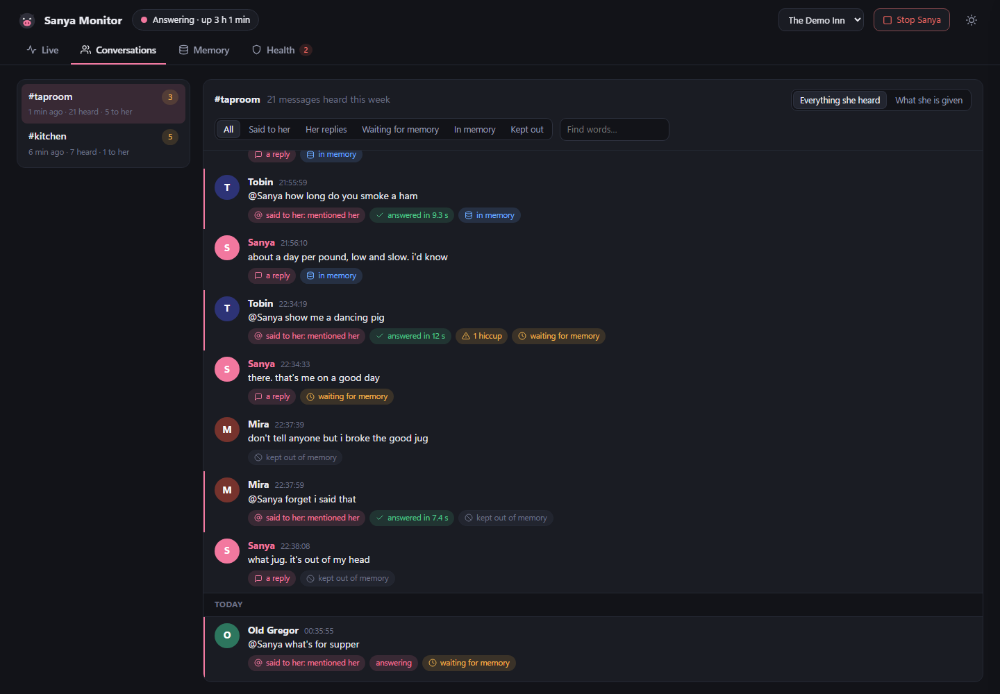
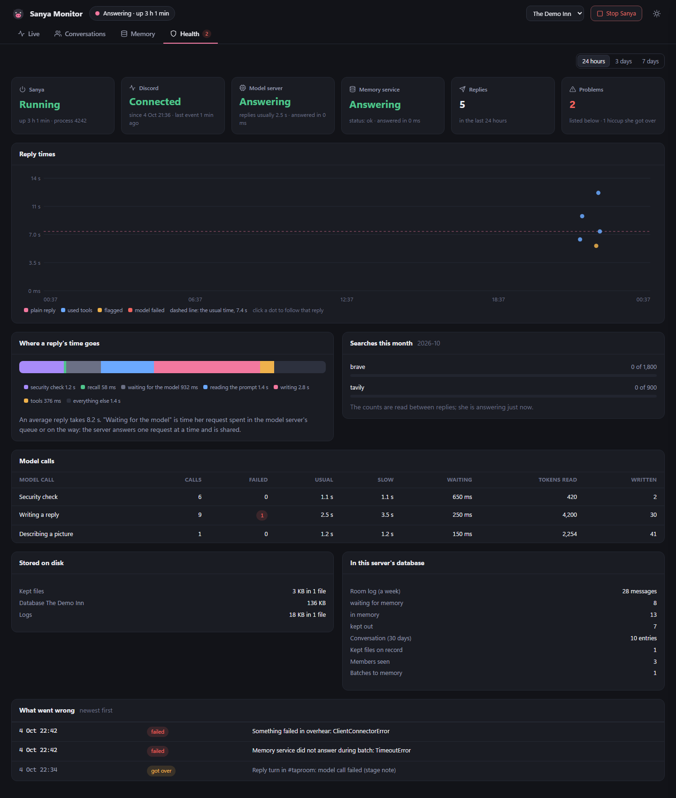

# Sanya Monitor

A page in the browser that shows what the bot is doing: what she hears, what she answers and
how, what goes to memory, and whether everything she leans on is up. It is a separate program
from the bot. It reads what she records and changes none of it.

Built at the owner's request and settled with the owner in an interview. Every
choice in it is the owner's; they are recorded in [SETTINGS.md](SETTINGS.md), under "Sanya
Monitor".

## Starting it

Double-click `Sanya Monitor.cmd` in the project folder. A window opens saying where the page is,
and the page opens in the browser at `http://127.0.0.1:7269/`.

- The monitor runs for as long as that window is open. Closing the window stops the monitor
  only. Sanya keeps running.
- Double-clicking again while it runs opens the page of the one already running.
- It does not need Sanya to be running. With her stopped it shows what she recorded up to then.

From a command line: `.venv\Scripts\python.exe -m monitor` (add `--no-browser` to leave the
browser alone, `--port 7300` to listen elsewhere for one run).

## What the page shows

The server picker at the top chooses which server is looked at; it lists the servers she is
switched on in. The pill beside the title says whether she is running, and for how long.

### Live


- **The strip of stages** counts what passed each stage of her pipeline in the last 24 hours:
  heard, said to her, security check, recall, model, tools, replies sent, and messages sent to
  memory. A stage flashes when something passes it, and shows a turning ring while a reply in
  progress is at that stage.
- **Activity** lists everything as it happens, newest first: each message heard, each reply turn
  with the words on both sides, each batch to memory, each picture kept and described, starts and
  stops, and anything that went wrong. The buttons above it narrow the list. "Show older" goes
  back as far as the log does.
- **Right now** says whether she is listening, answering (whom, where, at which stage, for how
  long) or stopped. Below it: what is waiting to go to memory per channel, and the day's totals.

Clicking a message or a reply opens it in the side panel.

### Following one message


The side panel follows one message from arriving to memory:

1. **Read**: when it arrived, or that it was read while catching up after a start.
2. **Recorded**: the message as it stands in the room log, with any files kept for it and what
   she was told each picture shows.
3. **Said to her**: whether it mentioned her or replied to her; if it did and she did not
   answer, why not.
4. **Reply turn**: every step with how long it took, drawn on one time line: the security check
   and its verdict, the recall and how many facts it brought (and,, how many
   of them were fetched by the name of the person she was answering, and how many earlier lines of
   the members' memory was asked with), each model call (tokens read and
   written, time spent waiting for the model server, reading and writing), each tool and search
   (with the words searched for, and a note when a tool call was itself her reply, so that no
   model call followed it), a reply replaced on the way out, an image, sticker or emoji, and the
   sending. A sticker's step says whether it went with her words or as her whole answer, or that
   Discord refused it; which sticker it was shows in her reply below, where the room log notes
   its name. A
   **Choices** row, for replies made from her first start, says what the turn
   was allowed and what came of it: the image mode (none, allowed unasked, asked for, a meme asked
   for) with the dice thrown, whether the channel was cooling down and whether the member wants no
   unasked images; whether a reaction was allowed, with its dice; how many tools were offered on
   each model call (none on the last call of the budget and on a flagged turn); how many tool
   requests were run and how many code refused; and the outcome of the image and of the reaction
   (she left it, she looked and nothing turned up, she looked and attached none, posted, would not
   upload). Each model call's row also says how many tools it was offered. Then what she had from
   memory for it: the facts put before her with the message, and the facts a memory tool handed
   her. Then her reply.
5. **Conversation**: that the turn was saved to the channel's conversation, with her notes on
   the tools she used.
6. **Memory**: waiting, sent (in which batch, with a button to open it), or kept out and why:
   flagged by the security check, read while catching up, held back when a member asked her to
   forget, her answer to a message that is kept out, or only bots spoke.

### Conversations



One channel at a time, picked on the left.

- **Everything she heard** is the room log: every message, with marks for what became of it
  (said to her, answered and how fast, flagged, waiting for memory, in memory, kept out). A reply
  on which the dice allowed an unasked image or an emoji reaction carries a mark saying so, whether
  or not she used it; what came of it is in the reply's Choices row. It can
  be narrowed to one kind and searched for words. It reaches back a week, as the room log does.
- **What she is given** is the channel's conversation: what was said to her and what she
  answered, with her tool notes and the untrusted mark. This is the part of the chat the model
  is handed with each reply. It reaches back 30 days.

A kept picture shows as a small preview beside its message, with what she was told it shows.
Clicking the preview shows the picture whole. A preview is fetched when it comes near the part of
the page being looked at, and other kinds of file are listed by name.

### Memory


- The bank's numbers from the memory service: facts, batches of chat, merged summaries, and when
  it was last written to.
- **Waiting to go to memory**: per channel, how many messages are waiting, against the rule that
  sends them (20 messages, or 10 quiet minutes).
- **Batches sent**: each batch with how many messages it held, how many facts were not kept and
  how long it took. Clicking one shows the chat that went, the facts kept, and the facts not
  kept with the reason for each.
- **Facts in the bank**, searchable by a word. "Not kept" lists the facts taken out of recall.
  "Summaries" lists what the service has merged out of the facts; she is never shown those.

### Health



- Whether Sanya is running and since when; her connection to Discord; whether the model server
  and the memory service answer.
- **Reply times** over the last 24 hours, 3 days or 7 days, one dot per reply. Clicking a dot
  follows that reply.
- **Where a reply's time goes**, averaged: security check, recall, waiting for the model server,
  reading the prompt, writing, tools, everything else.
- **Model calls** by purpose: how many, how many failed, the usual and the slow time, and the
  usual wait for the model server.
- **Searches this month** against each service's monthly allowance.
- What is stored on disk, what the server's database holds, and a list of what went wrong.
- **Problems and hiccups.** The red count on the Health tab is for what failed outright: a reply
  that did not go out, a service that did not answer, an error. Something that went wrong on the
  way and was got over, such as a model call that worked on its second try or a tool that did not
  work, is a hiccup: listed in a quieter colour, and not counted.
- When she is stopped: the last lines she wrote to her error output, which is where a failed
  start explains itself.

## Start and Stop

The button at the top right runs `scripts\Start-Sanya.ps1` or `scripts\Stop-Sanya.ps1`, the same
two scripts as the `Start Sanya.cmd` and `Stop Sanya.cmd` launchers, and shows what the script
printed. It asks before doing either.

- Start is refused while she is running.
- She runs as whoever starts her. Started from the page, that is the Windows account the monitor
  runs under. Only that account can stop her.
- If she was started under another Windows account, the page says so and the button is off.

## What it reads, and what it cannot do

| It reads | How |
|---|---|
| `logs\events.log` and the earlier days beside it | Opened, read and closed again every two seconds while the page is open. It is opened in a way that lets her rename it at midnight while it is held. |
| `data\guilds\<server>.db` | Opened read-only, for the length of one question. Her databases are in write-ahead mode, in which a reader does not hold up the writer. |
| `data\files\` | A kept picture is read to make its small preview, and again if it is opened whole. The preview is made in memory and kept there; nothing is written. |
| `data\usage.json` | Read only between replies. She replaces this file on every search, and Windows refuses that while another program has the file open; a search only happens well into a reply. |
| `data\sanya.pid` | To find her process, which is looked at and not touched. |
| `config\sanya.yaml` | Which servers and bank, where the two services are, the memory rules it explains. |
| The memory service | Its health page, the bank's numbers, and listings of facts and documents. Reading only. |
| The model server | Its health page only. No model call is ever made. |

| It cannot | Because |
|---|---|
| Change anything she has recorded | No code in it writes, renames or deletes a file, and its database connections are read-only. |
| Change her memory | The one function that reaches the memory service only fetches. |
| Read her token or keys | It never opens `.env`. |
| Start or stop her by itself | Only a press of the button, confirmed, runs one of the two scripts. |
| Be reached from another computer | It listens on `127.0.0.1` only. |
| Be read or driven by another site open in the browser | Every request must name this PC's own address as its host, and every request for data must carry a key that is handed out with the page and changes each time the monitor starts. |
| Run a member's message as part of the page | Everything a member wrote is put on the page as text, and the page allows no scripts but its own. |

## Settings

`config\monitor.yaml`:

| Setting | Value | Meaning |
|---|---|---|
| `port` | 7269 | The page is at `http://127.0.0.1:7269/`. |
| `history_days` | 7 | How many days of the event log are read when it starts. |
| `open_browser` | true | Open the page when the monitor starts. |
| `show_switched_off` | false | List the servers she is switched off in too. |
| `servers` | empty | A name to show for a server id, in place of the one she recorded. |
| `channels` | empty | A name to show for a channel id, in place of the one she recorded. |

Names: she records the names of channels and of the server herself. For a channel she has not named yet, the monitor uses the name she gave the
memory service with a batch of that channel's chat, and failing that shows the last four digits
of its id.

## What it cannot show

The bot does not record these, so the monitor has nothing to show for them:

- **The exact prompt** of a reply. The event log has sizes and timings, never text. Keeping the
  prompts was offered to the owner and not chosen.
- **What a tool was asked and what it returned.** The log has the tool's name, whether it
  worked and how long it took. When she looks back through the chat the step says how many lines she found; the words she looked for are not
  kept, since they will often be a member's name. Her own one-line note on each tool is in the conversation, and
  the facts a memory tool handed her are kept (see below). The one thing kept of what a tool was
  asked is the words of a search, from her first start: the page shows them
  on the reply's card ("searched:...") and on the search's step, with the service that
  answered, how many images were found and passed, and how many were the search service's own
  copy because the site refused the download. A search made before that was recorded shows without its words.
- **Why she chose as she did.** The Choices row shows what a turn was allowed, what was offered
  on each call, what she asked for and what came of it. Her reasoning is not kept and is not
  logged, so the page cannot say why she left an allowance alone or picked one image over another.
- **A clean stop.** Stopping her ends the process at once, so nothing is logged. The page shows
  her as stopped from the process itself.

Two things she records for the monitor since they were added. For replies made before that, the
page says so and shows what there is:

- **The names of channels and of the server.**
- **The facts she had from memory for each reply**, as a copy of their text, kept 30 days. A copy
  never outlives its fact: it goes when a member has her forget the fact, when a member deletes
  the message the fact came from, or when hearsay expires. She is never shown these copies.

## Trying it on made-up data

```powershell
.venv\Scripts\python.exe monitor\demo\demo.py
```

This serves the page at `http://127.0.0.1:7399/` over an invented server (`monitor\demo\world.py`):
no real chat, a stand-in for the two services, and Start and Stop buttons that only pretend. It
is what the pictures above show, and a way to see the page before she has recorded anything.

## Files

| Path | What it is |
|---|---|
| `monitor\files.py` | Opening her files and databases for reading without getting in her way. |
| `monitor\eventlog.py` | The event log, read as it grows and folded into turns, messages heard and background work. |
| `monitor\rooms.py` | The read-only questions put to a server's database. |
| `monitor\memory.py` | The read-only look at the memory service. |
| `monitor\health.py` | Is she running, do the services answer, what is stored. |
| `monitor\pictures.py` | Small previews of kept pictures, made in memory. |
| `monitor\control.py` | Start and Stop: the one place a script is run. |
| `monitor\server.py` | The web server: the page, the answers it asks for, and who may ask. |
| `monitor\settings.py` | The monitor's settings and the parts of the bot's that it shows. |
| `monitor\web\` | The page: `index.html`, `app.css`, and one script per view. No outside libraries. |
| `monitor\demo\` | The made-up server and the try-out script. |
